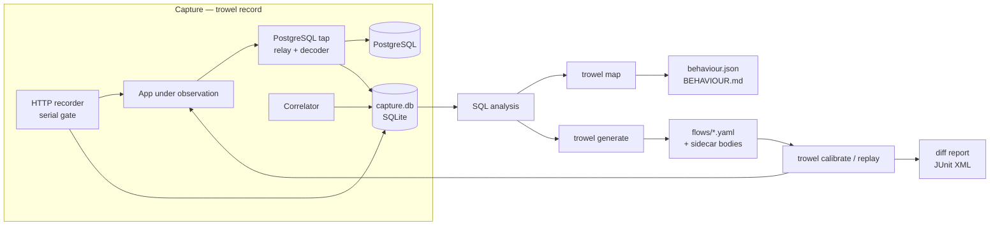

# 02 — Architecture

Status: accepted for the MVP, 11 November 2026. Details may change inside a step; changes to
the choices in this document are recorded in `04-decisions.md` first.

## 1. Overview

Trowel is one Go binary with five commands. All of them read or write two kinds of data:
a **capture store** (binary, local, never committed) and **artefacts** (plain text,
committed to the user's repository).



Two runtime modes use the same components:

| Mode | HTTP side | Database side |
|---|---|---|
| `record` | Reverse proxy; a person or script drives the app through it | Tap proxy records statements |
| `calibrate`, `replay` | Built-in HTTP client sends the recorded requests one by one | The same tap proxy records statements so they can be asserted |

## 2. Components

### 2.1 HTTP recorder (`internal/httprec`)

- `net/http/httputil.ReverseProxy` with the `Rewrite` hook.
- Request and response bodies are captured by wrapping the body readers and teeing into a
  capped buffer (default 1 MiB, then length and SHA-256 only). Bodies are never read whole
  inside the proxy hooks, so streaming keeps working.
- The outbound request asks for `Accept-Encoding: identity`; the original header is recorded.
- The inbound `Host` header is preserved, because legacy apps build URLs from it.
- **Serial gate:** one request in flight at a time. The gate stays closed after the response
  until the database tap has been idle for a short quiet period (default 50 ms), so
  statements issued after the response are still attributed. A bypass list (static assets,
  `Upgrade` requests, `text/event-stream`) skips the gate; bypassed exchanges are stored as
  `uncorrelated`.

### 2.2 PostgreSQL tap (`internal/dbtap`, `internal/dbtap/pg`)

Design: **relay and tap, fail open.** The proxy forwards raw bytes in both directions and a
decoder reads a copy. A decoder error marks the connection `undecoded` and the relay carries
on. The application must never see different bytes because of Trowel.

- Startup: answer `SSLRequest` and `GSSENCRequest` with `N`; forward `CancelRequest` on a
  fresh connection; forward `StartupMessage`. Authentication (md5, SCRAM-SHA-256) passes
  through untouched, so Trowel never needs the application's database password for tapping.
- Decoder: `pgproto3` from `github.com/jackc/pgx/v5`.
  - Simple protocol: `Query` → one statement row per `CommandComplete`.
  - Extended protocol: per-connection map of prepared statement name to SQL; FIFO of pending
    operations to match pipelined responses; parameters stored as text where possible and
    as hex otherwise.
  - `ReadyForQuery` carries the transaction status; statements inside a transaction that
    ends in `ROLLBACK` are flagged `rolled_back`.
  - Row count and affected-row count come from the `CommandComplete` tag. A SHA-256 over
    the row bytes is stored as a cheap result fingerprint; rows themselves are not stored.
- `dbtap` defines a small protocol-neutral interface (`Statement`, `ConnEvent`, `Tap`) so a
  MySQL implementation can be added later without touching the rest.

### 2.3 Correlator (`internal/correlate`)

Both proxies run in one process and share one monotonic clock. A statement belongs to the
request whose window contains its start time. Every link stores how it was obtained:

| Label | Meaning | Used for tests |
|---|---|---|
| `exclusive` | Statement started inside the only open request window | Yes |
| `exclusive-conn` | As above, and the connection lived entirely inside the window | Yes |
| `late` | Statement arrived in the quiet period after the response | Yes, flagged in the map |
| `ambiguous` | More than one candidate window (gate bypassed) | No |
| `background` | No window open | No |

`record` prints a summary of labels on exit. A high share of `background` or `ambiguous`
statements is reported as a problem with the recording, not hidden.

### 2.4 Capture store (`internal/store`)

One SQLite file per recording session, written through `modernc.org/sqlite` (pure Go, so the
binary stays static).

```
session(id, started_at, tool_version, snapshot_ref, config_json)
exchange(id, session_id, seq, started_ns, finished_ns, client_label, method, url,
         status, req_headers, resp_headers, req_body_id, resp_body_id, gate_mode)
body(id, sha256, size, truncated, content)
db_conn(id, session_id, opened_ns, closed_ns, db_user, db_name, decode_state)
statement(id, conn_id, seq, started_ns, finished_ns, protocol, sql, params_json,
          command_tag, row_count, affected_rows, result_sha256, error_code,
          tx_state, rolled_back)
link(exchange_id, statement_id, label)
analysis(statement_id, kind, fingerprint, tables_read, tables_written, parse_ok)
```

Redaction (`internal/redact`) runs before anything is written: `Authorization`, `Cookie`,
`Set-Cookie` values and body fields named like passwords or tokens are replaced by stable
placeholders. The original values needed for replay are kept in a separate `secret` table
that `generate` turns into `{{secret.NAME}}` references.

### 2.5 SQL analysis (`internal/sqlinfo`)

- Fingerprint and normalisation: `github.com/DataDog/go-sqllexer` (pure Go lexer).
- Statement kind and tables read or written: lexer metadata plus a small set of rules for
  `INSERT ... SELECT`, CTEs that modify data, and `RETURNING`.
- Behind an interface. If lexer-based table extraction proves too inaccurate on the pilot
  system, a parser build (`wasilibs/go-pgquery`, no CGO) replaces it without other changes.
- Unparsable statements are kept with `kind=unknown`; analysis never drops a recording.

### 2.6 Behaviour model and map (`internal/model`, `internal/mapgen`)

- Endpoint identity: method plus path template. Numeric, UUID and long-hex segments become
  parameters. A `routes` section in the config pins or overrides templates.
- `behaviour.json` is the model: endpoints, observed parameters with inferred types, status
  codes, tables read and written with row counts, top statement fingerprints, covering flows.
- `BEHAVIOUR.md` and one page per endpoint are rendered from the model: endpoint index,
  table-by-endpoint CRUD matrix, small Mermaid graphs, and findings (GET requests that
  write, the same fingerprint repeated many times in one request, writes without a session).
- Output is deterministic, so a changed map shows up as a readable diff in a pull request.

### 2.7 Flow tests (`internal/flow`)

One recording session becomes one flow: a directory with `flow.yaml` and sidecar files for
large or HTML bodies.

```yaml
version: 1
name: login-and-checkout
snapshot: trowel_snap_20261111_1
steps:
  - id: s1
    client: A
    request:
      method: POST
      path: /api/login
      json: { email: demo@example.com, password: "{{secret.DEMO_PASSWORD}}" }
    capture:
      token: { json: "$.token" }
    expect:
      status: 200
      headers: { content-type: application/json }
      body:
        kind: json
        file: s1.json
        match: { "$.token": jwt, "$.expires_at": timestamp }
      sql:
        writes: { sessions: { insert: 1 } }
        reads: [users]            # warn only
  - id: s2
    client: A
    request:
      method: POST
      path: /api/cart/items
      headers: { authorization: "Bearer {{token}}" }
      json: { product_id: 3, quantity: 2 }
    expect:
      status: 201
      body: { kind: json, file: s2.json }
      sql:
        writes: { cart_items: { insert: 1 }, carts: { update: 1 } }
```

Generation rules:

- Recorded `Cookie` headers are dropped; each `client` gets an empty cookie jar at flow start.
- Value correlation: token-like values in a response (`Set-Cookie`, hidden inputs, JSON
  leaves, ids in `Location`) that reappear in a later request of the same client become a
  `capture` on the source step and a `{{variable}}` in the later step.
- Everything that is not asserted is written into the file (`ignore`, typed `match`,
  `unordered`), so a reviewer can see it.

### 2.8 Replay, assertions, reporting (`internal/replay`, `internal/assert`, `internal/report`)

- **Reset** before each flow. Contract: a `reset.command` shell hook. Built-in helper for
  PostgreSQL using only SQL: `record` clones the application database into a snapshot
  (`CREATE DATABASE snap TEMPLATE app`); reset drops the application database with `FORCE`
  and clones it back from the snapshot. The tap drops the app's connections so pools
  reconnect. Non-database state (uploads, caches) is the user's hook.
- **Assertions**

  | Target | Rule |
  |---|---|
  | Status | Exact |
  | Headers | Allowlist: `Content-Type`, `Location`, cookie names and attributes, `Cache-Control`, `Content-Disposition` |
  | JSON body | Structural diff by path; strict by default; typed matchers and ignores |
  | HTML body | Parse, drop comments, collapse whitespace, sort attributes and classes, hash script and style, apply selector ignores, one node per line, line diff |
  | Other body | Content type, length and SHA-256 |
  | SQL writes | Tables written and affected rows per table and operation, rolled-back work excluded — **hard failure** |
  | SQL reads and fingerprints | Reported as a warning, never a failure |

- **Calibrate:** reset, replay, reset, replay. Whatever differs between the recording and
  either replay becomes an explicit rule in the step. Steps that still fail are quarantined
  with a reason.
- **Reporting:** console diff per failed step, JUnit XML, non-zero exit code, `--update` to
  approve an intended change.

## 3. Technology choices

| Concern | Choice | Reason |
|---|---|---|
| Language | Go, current stable release | Single static binary, strong networking standard library, protocol libraries exist |
| CLI | `spf13/cobra` | De facto standard, subcommands and help for free |
| PostgreSQL protocol | `jackc/pgx/v5` (`pgproto3`, `pgconn`) | Decodes both directions; used in production by a major driver |
| Store | SQLite via `modernc.org/sqlite` | Appendable, joins for correlation, no CGO |
| SQL fingerprints | `DataDog/go-sqllexer` | Pure Go, PostgreSQL and MySQL dialects |
| HTML parsing | `golang.org/x/net/html`, `andybalholm/cascadia` for selectors | Standard, small |
| YAML | `gopkg.in/yaml.v3` | Stable output ordering under our control |
| JSONPath | Minimal own implementation (member, index, wildcard) | Keeps the dependency list short; full JSONPath is not needed |
| Tests | Go `testing`, golden files, `testcontainers-go` for PostgreSQL integration tests | Real database in tests, like the product itself |
| CI and release | GitHub Actions, GoReleaser, `CGO_ENABLED=0` | Reproducible static builds for six targets |
| Demo app | Node.js, Express, `pg`, PostgreSQL, Docker Compose | Mirrors the pilot stack |

Exact versions are pinned in step 1 and checked against release notes then. Known floor:
pgx 5.9 and newer need Go 1.25 or newer; pgx must be 5.12.0 or newer because of two
security advisories fixed in that release (see research report 02).

All dependencies are MIT, BSD or Apache-2.0. Reference implementations under other licences
(Encore `pgproxy` is MPL-2.0, GoReplay is LGPLv3) are reading material only.

## 4. Repository layout

```
cmd/trowel/              main package
internal/cli/            cobra commands, config loading
internal/store/          SQLite schema, migrations, queries
internal/httprec/        recording reverse proxy, serial gate
internal/dbtap/          protocol-neutral tap interface, TCP relay
internal/dbtap/pg/       PostgreSQL startup handling and decoder
internal/correlate/      request windows, link labels
internal/redact/         redaction rules, secret references
internal/sqlinfo/        fingerprint, statement kind, tables
internal/model/          endpoint templating, behaviour model
internal/mapgen/         Markdown and Mermaid rendering
internal/flow/           flow schema, generator, value correlation
internal/replay/         runner, cookie jars, reset
internal/assert/         JSON diff, HTML diff, SQL assertions, matchers
internal/report/         console diff, JUnit XML
examples/legacy-shop/    demo application and Compose files
test/e2e/                end-to-end scenarios and seeded regressions
docs/                    this documentation
```

Files in the user's project:

```
trowel.yaml              configuration (committed)
.trowel/                 capture stores and local state (git-ignored)
trowel/flows/<name>/     flow.yaml and sidecar bodies (committed)
trowel/behaviour/        behaviour.json, BEHAVIOUR.md, endpoints/*.md (committed)
```

## 5. Deployment during recording

One service is added through a Compose override file; the application's database host
points at it. Nothing in the application's source changes.

```yaml
# compose.trowel.yaml — docker compose -f compose.yaml -f compose.trowel.yaml up
services:
  trowel:
    image: ghcr.io/OWNER/trowel:latest
    command: record --http-listen :8080 --http-upstream http://app:3000
                    --db-listen :5432 --db-upstream db:5432
    ports: ["8080:8080"]
    volumes: ["./.trowel:/data"]
    depends_on: [app, db]
  app:
    environment:
      DATABASE_HOST: trowel
```

On start, a preflight check connects to both upstreams and prints a plain instruction when
something is unsupported, for example "the client requires TLS: set `sslmode=prefer` for
recording".

## 6. Testing strategy

| Level | What | Where |
|---|---|---|
| Unit | Decoder state machine, correlation labels, templating, diffs, matchers | Next to the code, table-driven |
| Golden file | Map rendering, flow generation, normalised HTML | `testdata/` directories |
| Integration | Tap against real PostgreSQL versions with `pg`, `pgx` and `psql` clients | `testcontainers-go` |
| End-to-end | Record, map, generate, calibrate, replay on the demo app; five seeded regressions | `test/e2e`, GitHub Actions |

The end-to-end suite is the executable form of the acceptance criteria in `01-mvp-scope.md`.

## 7. Risks carried by this design

| Risk | Mitigation in the MVP |
|---|---|
| Wrong correlation produces wrong tests | Confidence labels; tests use high-confidence links only; summary on exit |
| Recordings leak credentials or personal data | Redaction on by default; `.trowel/` git-ignored; secrets as references |
| Proxy cannot be inserted (TLS required, Unix sockets, host-based rules) | Preflight with exact instructions; documented constraints |
| Serial gate breaks long-polling or slows pages | Bypass list; gate timeout with a warning |
| Lexer misreads tables in complex SQL | Interface allows a parser build; unknown statements are kept and reported |
| Database reset is too slow on large data | Reset once per flow; skip reset after flows without writes; advise small data sets |
| Development sandbox has an older Go toolchain and restricted module access | GitHub Actions is the reference build; versions pinned in step 1 |
