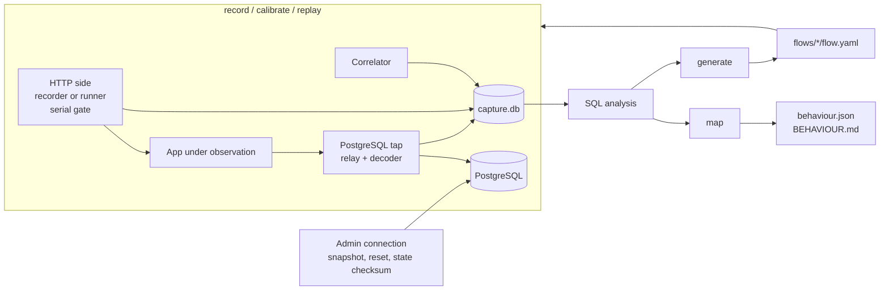

# 02 — Architecture

Status: revision 2, 11 November 2026. Revised after the technical review in `docs/reviews/`.
Changes to the choices in this document are recorded in `04-decisions.md` first.

Items marked **(confirm in step N)** are protocol or driver behaviour taken from the
research and the review, not yet proven by a test of our own.

## 1. Overview

Trowel is one Go binary. Its commands read or write two kinds of data: a **capture store**
(raw, local, never committed) and **artefacts** (plain text, redacted, committed to the
user's repository).



| Command | Release | Purpose |
|---|---|---|
| `init` | 0.1 | Write a starter `trowel.yaml` and Compose override |
| `record` | 0.1 | Proxy HTTP and PostgreSQL traffic into the capture store |
| `inspect` | 0.1 | Show exchanges and their statements from a store, redacted |
| `map` | 0.1 | Generate the behaviour map |
| `snapshot` | 0.2 | Create, list and drop named database snapshots |
| `generate` | 0.2 | Turn a recording into a flow test |
| `calibrate` | 0.2 | Replay twice, write unstable fields into the flow as rules |
| `replay` | 0.2 | Reset, replay, assert, report |

### Process model

`record`, `calibrate` and `replay` each own both listeners (HTTP and database) for their
lifetime; only one of them runs at a time. In Compose the service command is
`${TROWEL_CMD:-record}`, and switching mode recreates the Trowel container. The app loses
its database connections at that moment and must reconnect (constraint 6 in the scope), so
the runner polls a readiness URL (`ready.path`, with timeout) before the first step and
after every reset. Rejected alternative: one long-lived daemon with a control socket; more
moving parts for no gain in the MVP.

## 2. Components

### 2.1 HTTP recorder and serial gate (`internal/httprec`)

- `net/http/httputil.ReverseProxy` with the `Rewrite` hook.
- Bodies are captured by wrapping the body readers and teeing into a capped buffer.
  Response bodies: 1 MiB, then length and SHA-256 only. Request bodies: 32 MiB, because a
  truncated request cannot be replayed.
- The outbound request asks for `Accept-Encoding: identity`; the inbound `Host` header is
  preserved. The request is stored **as sent to the app**.
- **Serial gate.** One request in flight at a time. A request's window starts when it
  passes the gate, not when it arrives. The gate reopens when the response is complete and
  the tap has been **idle** for the quiet period (default 50 ms). Idle means: every tap
  connection has no pending operation, transaction status is "not in a transaction", and no
  client message arrived during the quiet period.
- Bypass list (static assets, `Upgrade` requests, `text/event-stream`): these skip the gate
  and are stored as `uncorrelated`. A gate timeout prints a warning.
- Known limitation: an app that calls its own URL through the proxy waits for the gate
  timeout.

### 2.2 PostgreSQL tap (`internal/dbtap`, `internal/dbtap/pg`)

Design: **relay and tap, fail open.** On the database connection the application never
sees different bytes because of Trowel.

**Relay.** One goroutine per direction forwards bytes. It frames messages itself (type byte
plus length), stamps each frame with the monotonic clock and a per-connection sequence
number, and puts a copy on a bounded queue. If the queue is full the connection is marked
`undecoded` and the relay carries on; the relay never waits for the decoder.

**Startup.** `SSLRequest` and `GSSENCRequest` are answered with `N`; `CancelRequest` is
forwarded on a fresh connection; a direct TLS hello is detected and reported.
Authentication (md5, SCRAM-SHA-256) passes through, so the tap never needs the
application's database password. **(confirm in step 7)**

**Decoder.** One goroutine per connection consumes frames of both directions in sequence
order and uses `pgproto3` (from `jackc/pgx/v5`) only to decode message bodies; strings are
copied out of its buffers.

- Simple protocol: one statement row per `CommandComplete`. Multi-statement text is split
  with the lexer; if the number of segments differs from the number of completions the
  whole text is stored with `parse_ok = false`.
- Extended protocol: statement map (name → SQL, added on `ParseComplete`), portal map
  (portal → statement), FIFO of pending operations, skip to `Sync` after an error,
  `PortalSuspended` (cursor fetches) folded into one statement row, `DEALLOCATE` and
  `DISCARD ALL` clear the maps. Parameters are stored as text where possible, hex otherwise.
- Transactions, for both protocols: end of transaction from the command tag plus the
  `ReadyForQuery` status; a savepoint stack for `ROLLBACK TO SAVEPOINT`; `COMMIT` in a
  failed transaction counts as rollback; an error in a multi-statement batch undoes the
  earlier statements of that batch; a connection closed inside a transaction counts as
  rollback. Affected statements get `rolled_back = true` when the outcome is known.
- `COPY` is relayed and recorded as one statement with operation `copy`.

**Pause.** The tap has a `paused` state for snapshot and reset: client connections are
closed once they are idle and outside a transaction, and new client connections wait
before their startup message is forwarded.

`dbtap` defines a protocol-neutral interface (`Statement`, `ConnEvent`, `Tap`) so MySQL
can be added without touching the rest.

### 2.3 Correlator (`internal/correlate`)

Both sides run in one process with one monotonic clock. A statement belongs to the request
whose window contains its arrival time. Every statement carries a label:

| Label | Meaning | Feeds hard assertions |
|---|---|---|
| `exclusive` | Arrived inside the only open window | Yes |
| `exclusive-conn` | As above, and the connection lived entirely inside the window | Yes |
| `late` | Arrived in the quiet period after the response | No — shown in the map and emitted as `sql.late_writes`, warn only |
| `ambiguous` | Cannot be attributed safely | No |
| `background` | No window open | No |
| `session` | `SET`, `SHOW`, catalogue look-ups issued by drivers and ORMs | Excluded from map and assertions |

Downgrade rules, because a time window is not proof when the app uses a pool:

- A fingerprint seen at least once as `background` in the session is `ambiguous` whenever
  it appears inside a window (catches in-process timers).
- A statement on a connection whose transaction was open before the window started is
  `ambiguous`.

`record` prints a summary on exit: counts per label and a histogram of how long after the
response statements arrived. A high share of `background` or `ambiguous` is reported as a
problem with the recording.

### 2.4 Capture store (`internal/store`)

SQLite through `modernc.org/sqlite` (pure Go). One file per recording; it holds the record
session and later the replay sessions that belong to it. A single writer goroutine applies
batched transactions in WAL mode, so proxies never block on disk and never see "database
is locked".

```
session(id, kind [record|calibrate|replay], started_at, tool_version, snapshot, config_json)
exchange(id, session_id, seq, step_id, started_ns, finished_ns, client_label, method, url,
         status, req_headers, resp_headers, req_body_id, resp_body_id, gate_mode)
body(id, sha256, size, truncated, content)
db_conn(id, session_id, opened_ns, closed_ns, db_user, db_name, decode_state)
statement(id, conn_id, seq, exchange_id NULL, label, arrived_ns, finished_ns, protocol,
          sql, params_json, command_tag, row_count, affected_rows, error_code,
          tx_state, rolled_back, parse_ok)
analysis(statement_id, kind, operation, fingerprint, tables_read, tables_written)
```

**The store is raw.** It contains credentials and personal data, lives under `.trowel/`,
and is git-ignored.

### 2.5 Redaction (`internal/redact`)

Redaction is applied at **every export boundary** (`inspect`, `map`, `generate`), not at
write time. Rules find secret values by header and field name (`Authorization`, cookies,
fields named like passwords or tokens, plus user rules). Each found value goes into a value
dictionary, and the **exact value is replaced wherever it occurs** in exported text: other
headers, URLs, bodies, SQL text and SQL parameters. Value correlation and client labels
work on raw values inside the tool and only placeholders leave it.

`generate` writes the originals needed for replay to `.trowel/secrets.env` (git-ignored).
`replay` resolves `{{secret.NAME}}` from the environment variable `TROWEL_SECRET_NAME`,
then from that file, and fails before the first request with the list of missing names.

### 2.6 SQL analysis (`internal/sqlinfo`)

- Fingerprint and normalisation for the map.
- Statement kind and **operation**: `select | insert | update | delete | upsert | merge |
  truncate | copy | call | session | unknown`.
- **Write targets come from explicit rules** anchored on `INSERT INTO`, `UPDATE [ONLY]`,
  `DELETE FROM`, `MERGE INTO`, `TRUNCATE`, `COPY … FROM`, including writes inside CTEs.
  Identifiers are normalised: unquoted names folded to lower case, quotes stripped, the
  default schema dropped.
- Tables read: joins, subqueries, `UPDATE … FROM`, `DELETE … USING`, comma joins; CTE names
  and `EXCLUDED` are not tables; `EXTRACT(… FROM …)` and similar are not table references.
- **Library is decided by a spike at the start of step 13:** `DataDog/go-sqllexer` (pure Go
  lexer) against `wasilibs/go-pgquery` (the real PostgreSQL parser as WebAssembly, no CGO),
  measured on the corpus for accuracy, binary size and speed. Research 02 prefers the
  parser, research 03 the lexer; the result is recorded in the decision log.
- A statement that cannot be analysed is kept with `operation = unknown`. If it could be a
  write, every assertion that would depend on it is marked `unasserted` with the reason.

### 2.7 Behaviour model and map (`internal/model`, `internal/mapgen`)

- Endpoint identity: method plus path template. Numeric, UUID and long-hex segments become
  parameters; a `routes` section in the config pins or overrides templates.
- `behaviour.json`: endpoints with sample counts, observed parameter names, status codes,
  content types, tables read and written with operations and row counts, top fingerprints,
  late writes. The map of several recordings is the union of their observations.
- Findings: GET requests that write; the same fingerprint many times in one request; writes
  without a session.
- Completeness notes: the header states that only observed behaviour is listed and that
  outbound calls are not observed. If an admin connection is configured, the catalogue is
  queried and tables with triggers or cascading foreign keys are flagged "effects not
  attributed to requests".
- One `BEHAVIOUR.md`: header, endpoint index, a section per endpoint, table-by-endpoint
  CRUD matrix, findings. Output is deterministic, so a changed map is a readable diff.
- `behaviour.json` has a documented, versioned schema, and the docs include a short page
  on handing the map to a coding agent as context.

### 2.8 Flow tests (`internal/flow`)

One recording becomes one flow: a directory with `flow.yaml` and sidecar files for bodies.

```yaml
version: 1
name: login-and-checkout
origin: http://shop.local:8080        # recorded scheme and host
snapshot: baseline                    # logical name, see 2.9
steps:
  - id: s1
    client: A
    request:
      method: POST
      path: /api/login
      json: { email: demo@example.com, password: "{{secret.DEMO_PASSWORD}}" }
    capture:
      token: { json: "$.token" }
    expect:
      status: 200
      headers: { content-type: application/json }
      body:
        kind: json
        file: s1.json
        match: { "$.token": jwt, "$.expires_at": timestamp }
      sql:
        writes: { sessions: { insert: 1 } }
  - id: s2
    client: A
    request:
      method: GET
      path: /account
    expect:
      status: 200
      body: { kind: html, unasserted: html-diff-not-supported }
      sql:
        writes: { audit_log: { insert: 1 } }
state:                                # end-of-flow checksum, see 2.10
  sessions:   { rows: 4,  columns: { id: 9f2c…, user_id: 11ab…, token: ignore } }
  audit_log:  { rows: 17, columns: { id: 77d0…, action: c41e…, created_at: ignore } }
```

Generation rules:

- No static-asset or bypassed exchange becomes a step. A step whose request body was
  truncated is generated as `skip: body-truncated`.
- **Client identity follows cookie lineage:** a request belongs to the client whose earlier
  response set a cookie it sends, so a login that rotates the session id stays one client.
  Without cookies: authorization value, then remote address plus user agent.
- Recorded `Cookie` headers are dropped; each client gets an empty jar at flow start.
- **Value correlation:** token-like values in a response (`Set-Cookie`, JSON leaves,
  `Location` ids, values in HTML found by pattern) that reappear in a later request of the
  same client become a `capture` on the source step and a `{{variable}}` in the later one.
  Capture selectors: JSON path, header, regular expression on the body.
- Built-in typed matchers at generation time: ISO timestamp, UUID, JWT, long hex or base64
  token. Integers are not loosened; with a reset database they are stable.
- Everything not asserted is visible in the file: `ignore`, typed `match`, `unordered`,
  `unasserted: <reason>`.
- A minimal JSON path (member, index, wildcard) is implemented in `internal/assert`.

### 2.9 Snapshot and reset (`internal/replay`)

Uses an **admin connection** (`reset.admin_dsn` or `TROWEL_ADMIN_DSN`) that goes directly
to the upstream database, connects to a maintenance database, and is not seen by the tap.

- `trowel snapshot create NAME` clones the current application database
  (`CREATE DATABASE … TEMPLATE …`), records owner, grants and database-level settings, and
  blocks connections to the snapshot. `list` and `drop` manage them. `record` creates a
  snapshot at start unless one with the same schema checksum exists.
- The flow stores the **logical** snapshot name plus a checksum of schema and per-table row
  counts. In CI: seed the database, `trowel snapshot create baseline`, replay. A checksum
  mismatch is a warning before replay starts.
- **Reset sequence:** (1) gate closed; (2) tap paused; (3) admin connection drops the
  application database with `FORCE` and clones it from the snapshot with the recorded
  owner, then re-applies grants and settings; (4) optional `reset.command` hook for
  non-database state; (5) tap resumes; (6) wait for readiness.
- If sessions outside the tap are connected, the error lists them. Preflight checks server
  version (13 or newer), ownership, the right to create databases, and the absence of
  prepared transactions and replication slots, which `FORCE` cannot remove.
  **(confirm in step 25)**
- Reset runs before every flow, without exception: sequences advance even on rollback.

### 2.10 Replay, assertions, calibration, reporting (`internal/replay`, `internal/assert`, `internal/report`)

**Runner.** Builds URLs from `origin`, dials the upstream directly, never follows redirects
(each recorded hop is its own step), sends one request at a time through the same window
and quiet-period code as the gate, and stores replay statements per step.

**Assertions**

| Target | Rule | Failure |
|---|---|---|
| Status | Exact | Hard |
| Headers | Allowlist: `Content-Type`, `Location`, cookie names and attributes, `Cache-Control`, `Content-Disposition` | Hard |
| JSON body | Structural diff by path; strict by default; typed matchers, ignores, `unordered` | Hard |
| HTML and other bodies | Not compared in the MVP; marked `unasserted` in the flow | — |
| SQL writes per step | Tables written and affected rows per table and operation; rolled-back work excluded; zero-row entries removed before comparison; statements with CTE writes compare table and operation only | Hard |
| Late writes | Listed | Warning |
| **State at end of flow** | Per written table: row count and a per-column checksum over the multiset of values | Hard |

**State checksum.** After the last step, over the admin connection, each column of each
table written during the flow is hashed over its sorted text values, so no primary key and
no row order is needed. This catches a wrong stored value, which write counts cannot, and
it catches trigger effects on those tables. `state.tables: all` widens it to every table.
Tables above a size limit fall back to row count only, visibly. **(confirm in step 29:
stable text output for all column types in the demo and pilot schemas)**

**Calibrate.** Reset, replay, reset, replay.

- Replay 1 differs from replay 2 → noise: a typed matcher, `ignore` or `unordered` for
  response fields; `ignore` for a state column.
- Recording differs from both replays, which agree → **systematic difference**: the step is
  quarantined with a reason; nothing is loosened. `--accept-baseline` rewrites the
  expectation to the replayed value on request.
- A status or SQL-write difference always quarantines.

**Reporting.** Console diff per failed step with JSON path or table name; later failures in
a flow after a failed writing step are marked "possibly consequential"; JUnit XML in the
Jenkins-compatible format; exit codes by failure class; `--update` rewrites expectations
for selected steps.

## 3. Technology choices

| Concern | Choice | Reason |
|---|---|---|
| Language | Go, current stable release | Single static binary, strong networking library, protocol libraries exist |
| CLI | Standard library `flag` with a small dispatcher | Shortest possible dependency list (decision D28) |
| PostgreSQL protocol | `jackc/pgx/v5` (`pgproto3` for decoding, `pgconn` for the admin connection) | Decodes both directions; used in production by a major driver |
| Store | SQLite via `modernc.org/sqlite` | Appendable, joins for correlation, no CGO |
| SQL analysis | Decided in step 13 between `DataDog/go-sqllexer` and `wasilibs/go-pgquery` | See 2.6 |
| YAML | `goccy/go-yaml` | No dependencies; errors with line and column (decision D29) |
| Line diff | A small pure-Go unified diff library, pinned in step 21 | Console and report diffs |
| JUnit output | Jenkins-compatible JUnit XML, validated in CI against a checked-in XSD | Read by every common CI system |
| Tests | Go `testing`, golden files, `testcontainers-go` for PostgreSQL | Real database in tests, like the product itself |
| CI and release | GitHub Actions, GoReleaser, `CGO_ENABLED=0` | Reproducible static builds |
| Docker image | Small base that contains `/bin/sh` | The `reset.command` hook needs a shell |
| Demo app | Node.js, Express, `pg`, PostgreSQL, Docker Compose | Mirrors the pilot stack |

Versions are pinned in step 1 and checked against release notes then. Known floor from
research 02: pgx 5.12.0 or newer because of two security advisories; pgx 5.9 and newer
need Go 1.25 or newer.

All dependencies are MIT, BSD or Apache-2.0. Reference implementations under other licences
(Encore `pgproxy`, GoReplay) are reading material only.

## 4. Repository layout

```
cmd/trowel/              main package
internal/cli/            command dispatch, global flags, help, exit codes
internal/config/         trowel.yaml loading, environment overrides, validation
internal/buildinfo/      version, commit and platform of the running binary
internal/store/          SQLite schema, migrations, single writer
internal/httprec/        recording reverse proxy, serial gate
internal/dbtap/          protocol-neutral tap interface, relay, queue, pause
internal/dbtap/pg/       PostgreSQL startup handling and decoder
internal/correlate/      windows, labels, downgrade rules
internal/redact/         secret rules, value dictionary
internal/sqlinfo/        fingerprint, operation, tables
internal/model/          endpoint templating, behaviour model, findings
internal/mapgen/         Markdown rendering
internal/flow/           flow schema, generator, value correlation
internal/replay/         runner, cookie jars, snapshot, reset, state checksum
internal/assert/         JSON path, JSON diff, matchers, SQL and state assertions
internal/report/         console diff, JUnit XML
examples/legacy-shop/    demo application, Compose files, expected.yaml
test/e2e/                end-to-end harness, seeded regressions
docs/                    this documentation
```

Files in the user's project:

```
trowel.yaml              configuration (committed)
.trowel/                 capture stores, secrets.env, local state (git-ignored)
trowel/flows/<name>/     flow.yaml and sidecar bodies (committed, redacted)
trowel/behaviour/        behaviour.json, BEHAVIOUR.md (committed, redacted)
```

## 5. Deployment

```yaml
# compose.trowel.yaml — docker compose -f compose.yaml -f compose.trowel.yaml up
services:
  trowel:
    image: ghcr.io/OWNER/trowel:latest
    command: ${TROWEL_CMD:-record}
    environment:
      TROWEL_HTTP_UPSTREAM: http://app:3000
      TROWEL_DB_UPSTREAM: db:5432
      TROWEL_ADMIN_DSN: postgres://owner:…@db:5432/postgres   # replay only
    ports: ["8080:8080"]
    volumes: [".:/work"]
    depends_on: [db]
  app:
    environment:
      DATABASE_HOST: trowel
    depends_on: [trowel]
    restart: unless-stopped
```

- Start order: database, Trowel, app. The HTTP upstream check retries until the app is up.
- Mode switch: `TROWEL_CMD=replay docker compose up -d --force-recreate trowel`.
- A client that insists on TLS can only be seen when it connects, so the tap reports it
  then, with a message per driver family: node-postgres "remove `ssl` or use
  `sslmode=disable`" (its `prefer` turns TLS on); libpq-based drivers "use
  `sslmode=prefer` or `disable`". Preflight probes the upstream for a server that demands TLS.

## 6. Testing strategy

| Level | What | Where |
|---|---|---|
| Unit | Decoder state machine, labels, templating, diffs, matchers, write-target rules | Next to the code, table-driven; also run on macOS and Windows runners |
| Golden file | `inspect`, map, flow generation, reports | `testdata/` directories |
| Integration | Tap against the oldest supported and the newest PostgreSQL with `pg`, `pgx` and `psql` | `testcontainers-go` |
| End-to-end | The demo app in Compose with Trowel in between, from step 5 on; checks driven by `expected.yaml` | `test/e2e`, GitHub Actions |
| Reality check | A system we did not write | Steps 18 and 34 |

## 7. Risks carried by this design

| Risk | Mitigation in the MVP |
|---|---|
| Wrong correlation produces wrong tests | Labels and downgrade rules; only high-confidence statements feed hard assertions; delay histogram; reality check after M1 |
| Recordings leak credentials or personal data | Raw store stays local; value-dictionary redaction at every export; search tests in CI |
| Proxy cannot be inserted (TLS required, Unix sockets, host-based rules) | Preflight and run-time messages with exact instructions; documented constraints |
| App crashes when its database connections drop | Restart policy in the override; readiness wait; documented constraint; the demo app has no pool error handler on purpose |
| Reset changes database-level properties | Owner, grants and settings recorded and re-applied; tested with a non-default owner and `search_path` |
| SQL analysis misreads tables | Spike before choosing the library; explicit write-target rules; `unasserted` when unsure |
| One command tag per statement hides CTE and trigger writes | Operation vocabulary; end-of-flow state checksum |
| Calibration hides real differences | Systematic differences quarantine instead of loosening |
| Serial gate breaks long-polling or slows pages | Bypass list; gate timeout with a warning |
| Development sandbox has an older Go toolchain and restricted module access | GitHub Actions is the reference build |
